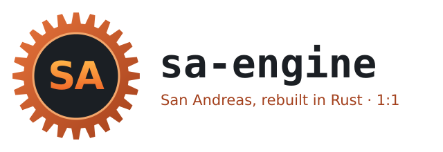
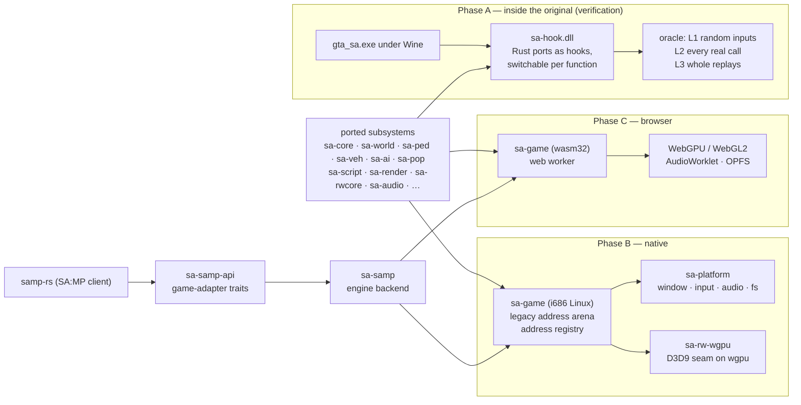

<p align="center"></p>

<p align="center">
  <a href="docs/GETTING-STARTED.md"><b>Getting started</b></a> ·
  <a href="docs/arch/ADR-003-code-architecture.md">Architecture</a> ·
  <a href="docs/verify/HOWTO.md">Verification</a> ·
  <a href="catalog/progress.md">Progress</a> ·
  <a href="docs/ROADMAP.md">Roadmap</a>
</p>

<p align="center">
  
  
  
  
</p>

---

**sa-engine** is a function-by-function Rust reimplementation of **GTA San Andreas PC 1.0 US** (`gta_sa.exe`),
verified against the original binary as it goes. Each ported function is compared with the original — on random
inputs, on every call during real play, and over whole recorded sessions frame by frame — before it counts as done.

The same engine runs:

- **natively on Linux**, without Wine and without executing any original code;
- **in the browser** (WebAssembly, WebGPU or WebGL2, Web Audio);
- **online on SA:MP 0.3.7-R4 / open.mp servers**, natively and in the browser, through the Rust SA:MP client in
  [`samp-rs/`](samp-rs/) (the browser connects through a small WebSocket ↔ UDP relay, `sa-udp-proxy`).

> [!NOTE]
> No game data is included. sa-engine reads **your own** GTA San Andreas installation; `gta_sa.exe` 1.0 US is
> checked by SHA-256. This project is not affiliated with or endorsed by Rockstar Games or Take-Two Interactive.

## Contents

- [Status](#status)
- [Quick start](#quick-start)
- [How it works](#how-it-works)
- [Repository layout](#repository-layout)
- [Development](#development)
- [Documentation](#documentation)
- [Acknowledgements](#acknowledgements)

## Status

| Area | State |
|---|---|
| Native Linux build | Boots to the main menu, New Game, free roam at Grove Street: walking, sprinting, jumping, fighting, vehicles (enter, drive, exit, jacking), traffic and pedestrians, audio |
| Story | The opening mission runs natively through the airport cutscene, the police-car ride and the drop-off; missions are being brought up one by one |
| Browser build | Same engine in a web worker (OffscreenCanvas, WebGPU / WebGL2, AudioWorklet), full-window and fullscreen |
| SA:MP | Joins 0.3.7-R4 / open.mp servers natively and in the browser: original loading screen, class selection (`<<` `>>` `Spawn`), chat, dialogs, scoreboard, textdraws, nametags |
| Verification | Every recording of the corpus replays bit-identical (17 subsystem hashes per frame) with the ports on |

Function coverage is tracked per subsystem in [`catalog/progress.md`](catalog/progress.md) (generated from
[`catalog/state.csv`](catalog/state.csv)); the work queue and decisions are in [`docs/ROADMAP.md`](docs/ROADMAP.md),
the step-by-step history in [`docs/WORKLOG.md`](docs/WORKLOG.md), and the current hand-off in
[`docs/CONTINUE.md`](docs/CONTINUE.md).

## Quick start

Full instructions: [machine setup](docs/GETTING-STARTED.md#2-machine-setup), [game files](docs/GETTING-STARTED.md#3-your-game-files), [build](docs/GETTING-STARTED.md#4-build) and [run](docs/GETTING-STARTED.md#5-run-it) in the getting-started guide.

```sh
# native (32-bit Linux)
make build                        # cargo build --release --target i686-unknown-linux-gnu -p sa-game
make run GAME=/path/to/gta-sa     # windowed, real keyboard and mouse

# browser
make web                          # wasm32 build into web/pkg
tools/web/serve.sh --game /path/to/gta-sa        # then open http://localhost:8642/?autostart=1

# browser + SA:MP (private open.mp server, relay and web server, all on 127.0.0.1)
make web-samp
SAMP_DIR=re/samp/client tools/web/samp-demo.sh   # prints the URL to open
```

`make help` lists every target.

## How it works

The original game is replaced from the inside out, one function at a time, and every step is checked against it.



- **Phase A** runs the original executable with our DLL injected. Every ported function is a hook that can be
  switched between Rust and the original at run time, which is what makes exact comparison possible
  ([`docs/PLAN.md`](docs/PLAN.md), [`docs/verify/HOWTO.md`](docs/verify/HOWTO.md)).
- **Phase B** runs the same ports as a native 32-bit Linux program: the original data sections are mapped at their
  original addresses and an address registry dispatches every call to its port
  ([`docs/arch/platform.md`](docs/arch/platform.md)).
- **Phase C** is the same program built for `wasm32`, where pointers are 32-bit too, so the same layout holds.
- Code structure follows [ADR-001](docs/arch/ADR-001-globals-and-layouts.md) (globals, layouts, calls into the
  original, hook registration), [ADR-002](docs/arch/ADR-002-partial-ports.md) (partial ports) and
  [ADR-003](docs/arch/ADR-003-code-architecture.md) (architecture and patterns: ports and adapters, one source of
  truth, typed views, layering).

## Repository layout

| Path | Contents |
|---|---|
| [`crates/`](crates/) | The Rust workspace: one crate per original subsystem (`sa-ai`, `sa-anim`, `sa-audio`, `sa-cam`, `sa-hud`, `sa-input`, `sa-ped`, `sa-pop`, `sa-render`, `sa-rwcore`, `sa-script`, `sa-stream`, `sa-veh`, `sa-weapon`, `sa-world`), the core (`sa-core`, `sa-math`, `sa-macros`, `sa-ports`), the platform and front ends (`sa-platform`, `sa-rw-wgpu`, `sa-game`), the verification harness (`sa-hook`, `sa-launcher`, `sa-oracle`), SA:MP integration (`sa-samp-api`, `sa-samp`, `sa-net`, `sa-udp-proxy`) |
| [`samp-rs/`](samp-rs/) | The Rust SA:MP 0.3.7-R4 client (its own Cargo workspace) |
| [`catalog/`](catalog/) | The function catalogue of `gta_sa.exe` 1.0 US: every function, its subsystem, call graph, layouts and port state (addresses and names only) |
| [`docs/`](docs/) | Plan, roadmap, architecture decisions, per-subsystem specifications, verification reports |
| [`tools/`](tools/) | Catalogue builders, code generators, the end-to-end and verification harness, web tooling |
| [`web/`](web/) | The browser front end (page, worker, audio worklet) |

## Development

```sh
make check        # the writer gate: clippy (host, i686, wasm32), builds, hook registration tests, L1, queue
make test         # fast tests: hook registration checks and core crates
make verify TAG=mytag LANES=1,2,3   # verify-all: every recording replayed with the ports on (Wine lanes)
make frontier     # functions that ported code calls but that are not ported yet
```

How a function is ported, verified and promoted: the getting-started guide, [how a function gets ported](docs/GETTING-STARTED.md#7-how-a-function-gets-ported) and [how ports are verified](docs/GETTING-STARTED.md#8-how-ports-are-verified).

## Documentation

| I want to… | Read |
|---|---|
| set up the machine and run something | [Getting started: setup, build, run](docs/GETTING-STARTED.md#2-machine-setup) |
| understand the method (phases, oracle levels, definition of done) | [`docs/PLAN.md`](docs/PLAN.md), [Getting started: what this project is](docs/GETTING-STARTED.md#1-what-this-project-is) |
| know the code rules and patterns | [`docs/arch/ADR-003-code-architecture.md`](docs/arch/ADR-003-code-architecture.md) |
| port a function | [Getting started: porting](docs/GETTING-STARTED.md#7-how-a-function-gets-ported) |
| verify ports against the original | [`docs/verify/HOWTO.md`](docs/verify/HOWTO.md), [Getting started: verification](docs/GETTING-STARTED.md#8-how-ports-are-verified) |
| see what is done and what is next | [`catalog/progress.md`](catalog/progress.md), [`docs/ROADMAP.md`](docs/ROADMAP.md), [`docs/CONTINUE.md`](docs/CONTINUE.md) |
| run SA:MP natively or in the browser | [`docs/samp/`](docs/samp/), [`docs/samp/web-proxy.md`](docs/samp/web-proxy.md) |

## Acknowledgements

- [gta-reversed](https://github.com/gta-reversed/gta-reversed) — its reversed C++ is a reading aid for many ports;
  where it differs from the 1.0 US bytes, the bytes win ([`catalog/gr-deviations.csv`](catalog/gr-deviations.csv)).
- [open.mp](https://www.open.mp/) — the server used for local SA:MP testing.
- [wgpu](https://wgpu.rs/), [winit](https://github.com/rust-windowing/winit), [cpal](https://github.com/RustAudio/cpal),
  [unicorn](https://www.unicorn-engine.org/) and the rest of the Rust ecosystem this builds on.
